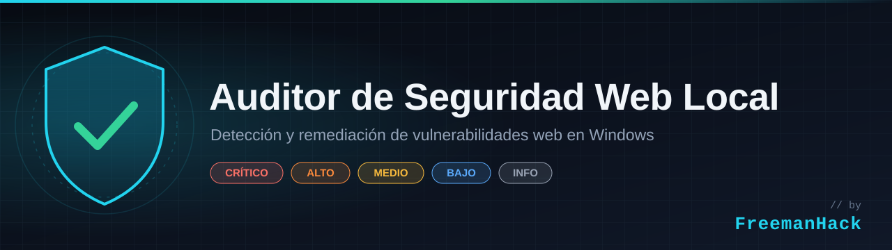
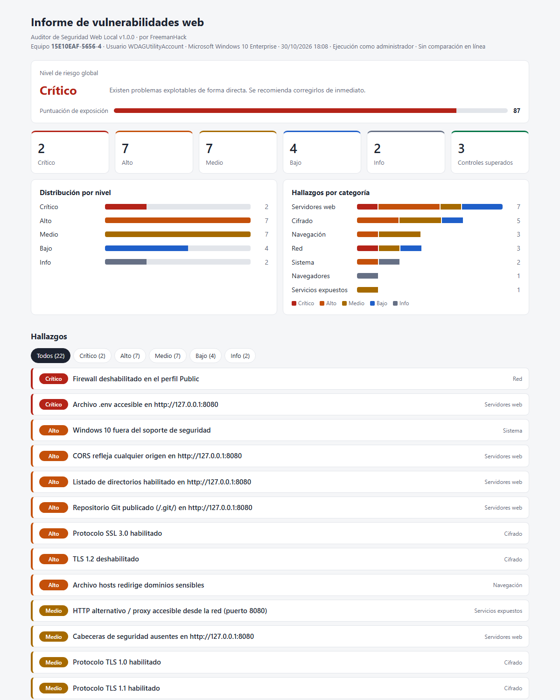
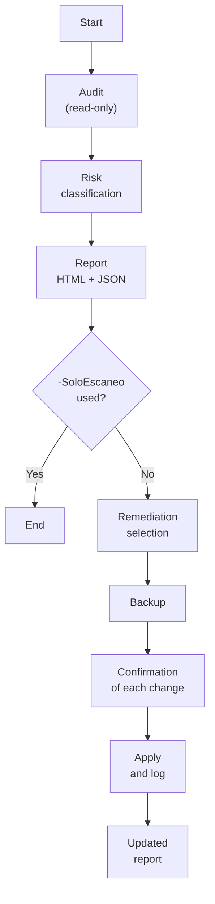

<p align="center">
  
</p>

<p align="center">
  
  
  
  
</p>

<p align="center"><a href="README.md">Español</a> · <b>English</b></p>

# Local Web Security Auditor

A PowerShell script that detects and remediates web-related vulnerabilities on Windows machines. It reviews listening HTTP services, the system TLS configuration, browser versions, outdated software and the network settings abused in spoofing attacks.

The workflow has three stages:

1. **Audit:** every check runs against the machine.
2. **Classification:** each finding is assigned a risk level and all of them are compiled into an HTML report.
3. **Remediation:** the console offers to apply the available fixes. Each one shows the exact command and asks for confirmation, and the registry and firewall are backed up before the first change.

> **Scope:** the tool only checks the machine it runs on. If it finds web servers there, it analyzes each one on the local address where it listens (`127.0.0.1`, `::1` or the machine's network IP). It never scans other machines on the network or internet sites.

> **Language note:** the tool's console output and HTML report are in Spanish. Parameter names are in Spanish as well (for example, `-SoloEscaneo` means *scan only*).

<p align="center">
  
</p>
<p align="center"><sub>Report generated in Windows Sandbox during the remediation test.</sub></p>

## Contents

- [Quick start](#quick-start)
- [Why use it?](#why-use-it)
- [How it works](#how-it-works)
- [Checks](#checks)
- [Requirements](#requirements)
- [Usage](#usage)
- [Report](#report)
- [Assisted remediation](#assisted-remediation)
- [Reverting changes](#reverting-changes)
- [Risk classification](#risk-classification)
- [Script signing](#script-signing)
- [Testing](#testing)
- [Limitations](#limitations)
- [FAQ](#faq)
- [Privacy](#privacy)
- [Disclaimer](#disclaimer)
- [Contributing](#contributing)
- [Security](#security)
- [Author](#author)
- [License](#license)

## Quick start

1. Download `AuditorWebLocal.ps1` from the [latest release](../../releases/latest).
2. Open PowerShell **as administrator** in the folder where you saved it and unblock the file:
   ```powershell
   Unblock-File .\AuditorWebLocal.ps1
   ```
3. Run it:
   ```powershell
   powershell -ExecutionPolicy Bypass -File .\AuditorWebLocal.ps1
   ```

When it finishes, the report opens in your browser and the console offers to apply the available remediations. If you only want the assessment, add `-SoloEscaneo`.

## Why use it?

In an organization, an attacker only needs one misconfigured machine. There is no need to breach the perimeter firewall or the best-protected server: a developer's workstation with a service left open, or a desktop that still answers LLMNR queries, is enough. From there, the attacker can move on to the rest of the network.

These weaknesses are not unusual. Many are enabled by default in Windows, others appear through everyday work, and almost none of them trigger alerts.

### What can happen

| Weakness | Impact on the organization |
|---|---|
| Development server listening on `0.0.0.0` with an exposed `.env` file | Any machine on the network obtains database credentials, API keys or production secrets. |
| Published `.git` repository | The full source code can be rebuilt, including any password ever committed to the history. |
| LLMNR or NetBIOS enabled | An attacker on the network captures employees' NTLMv2 hashes to crack or relay them (*NTLM relay*) and move laterally. |
| Permissive CORS on a local service | A malicious site visited by the user reads the internal application's data through the user's own browser, even though the service is not exposed to the network. |
| Outdated browser | Opening a malicious page is enough to run an exploit; browser vulnerabilities regularly appear in the [CISA KEV](https://www.cisa.gov/known-exploited-vulnerabilities-catalog) catalog of actively exploited flaws. |
| Tampered `hosts` file or proxy | Corporate credentials are sent to a fake site even when the user types the correct address. |
| Unsupported operating system | Every new vulnerability stays unpatched for good. |

### Why it goes unnoticed

None of the usual tools review these weaknesses as a whole:

- **Application scanners** (OWASP ZAP, Burp Suite, Nikto) assess a specific site, not the configuration of the machine that hosts or consumes it.
- **Antivirus or EDR** detects malware and suspicious behavior, not insecure configuration.
- **Windows Update** patches the system but does not change insecure defaults such as LLMNR, NetBIOS or legacy TLS protocols.
- **Network vulnerability scanners** see the machine from the outside, so they miss what is only visible from within: `hosts` files, proxies, loopback-only services or unsupported software.

### What it brings to an organization

- **Consistent assessment of workstations**, especially those of developers and administrators, which concentrate privileges, credentials and local services.
- **Risk-based prioritization**, so the IT team spends its time first on what could compromise the network.
- **Audit evidence:** timestamped HTML and JSON reports per machine, with the technical details and status of each finding.
- **Change traceability:** every remediation is shown before it is applied, confirmed individually, logged, and can be reverted from the backup.
- **Support for security frameworks:** it contributes to the secure configuration and technical vulnerability management controls of [CIS Controls v8](https://www.cisecurity.org/controls/v8) (controls 4 and 7) and ISO/IEC 27001:2022 (controls A.8.8 and A.8.9). The tool does not certify compliance, but it provides evidence to demonstrate it.
- **No added supply-chain risk:** a single auditable script that relies only on native Windows components. It installs no agents, has no external dependencies and sends no machine data to third parties.
- **Verifiable code:** every check is documented with its technical reference (RFC, CVE, CWE, OWASP, MITRE ATT&CK), so the security team can validate the criteria before adopting it.

Detecting these weaknesses takes a few minutes per machine. Responding to an incident caused by any of them can take weeks.

## How it works



1. **Start.** The script checks whether it has administrator rights and whether `winget` is available, since this determines which checks and remediations it can run.
2. **Audit.** Eleven independent checks run, each covering one area: operating system, firewall, antivirus, listening ports, web servers, TLS protocols, name resolution, browsers, outdated software, `hosts` file and proxy. This stage only reads the configuration. Each web server is analyzed on the local address where it listens (`127.0.0.1`, `::1` or the network IP), without following redirects or going through the system proxy.
3. **Classification.** Each finding is assigned a risk level. If a web server is only reachable from the machine itself, its findings are lowered by one level, except for CORS. All findings are then used to compute the overall level (the most severe one) and the exposure score (the sum of the weights).
4. **Report.** The HTML report, which opens in the browser, and the JSON file with the same data are generated.
5. **Remediation.** Unless `-SoloEscaneo` was specified, the console lists the findings that have a remediation available. The registry and firewall are backed up before the first change; then each remediation shows its command, asks for confirmation, runs and is logged. When finished, the report is regenerated with the updated status.

There are two kinds of remediation:

- **Automatic:** they change the configuration directly, for example disabling TLS 1.0, blocking a port in the firewall or updating a browser with `winget`.
- **Assisted:** they open the right tool so the user can decide, such as Windows Update, the `hosts` file or Programs and Features.

Issues specific to each web application, such as a published `.env` file or missing security headers, are not fixed automatically because the solution depends on each server. The report includes a recommendation for each case, with configuration examples for common servers such as Apache, nginx or IIS.

### Design decisions

- **Audit and remediation are separate.** Checks never modify the machine; changes only happen during the remediation stage and with explicit confirmation.
- **No change is hidden.** Each remediation shows the exact code that will run, and that same code appears in the report and in the JSON file.
- **Every change is reversible.** The backup is created before the first modification, and the rollback procedure is documented and tested.
- **A failure does not stop the audit.** If a check cannot run, for example due to missing permissions, it is recorded as an informational finding and the rest continue.
- **The report does not trust machine data.** Everything that comes from the audited system (HTTP headers, process names, `hosts` entries) is encoded before being written to the HTML, so a malicious server cannot inject code into it.
- **No dependencies.** Only native Windows components and PowerShell 5.1 are used, with no external modules or installation.

The script's internal structure, the role of each component and the steps to add a new check are described in [docs/arquitectura.md](docs/arquitectura.md) (in Spanish).

## Checks

| Category | What is checked | Max risk | Automatic remediation |
|---|---|---|---|
| System | Windows 10 out of support (build < 22000) | High | No (opens Windows Update) |
| System | Days since the last installed update (> 35 / > 60) | High | No (opens Windows Update) |
| System | Defender real-time protection and signature age | High | Yes |
| Network | Disabled firewall profiles | Critical | Yes |
| Network | LLMNR enabled (LLMNR/WPAD poisoning) | Medium | Yes |
| Network | NetBIOS over TCP/IP enabled (NBT-NS) | Low | Yes |
| Exposed services | Web and database ports listening beyond loopback | High | Yes (inbound block rule) |
| Web servers | Software version disclosed in `Server` or `X-Powered-By` | Low | No |
| Web servers | Missing `CSP`, `X-Frame-Options`, `X-Content-Type-Options`, `Referrer-Policy` or `HSTS` | Medium | No |
| Web servers | CORS reflecting any `Origin` or using the `*` wildcard | High | No |
| Web servers | Cookies without `HttpOnly`, `Secure` or `SameSite` | Low | No |
| Web servers | Directory listing at the root | High | No |
| Web servers | Published sensitive files: `.env`, `.git/HEAD`, SQL dumps, `web.config`, `phpinfo`, `phpMyAdmin`, `server-status`, `.htaccess` | Critical | No |
| Web servers | XAMPP MySQL with a passwordless `root` account | High | No |
| Encryption | SSL 3.0, TLS 1.0 and TLS 1.1 enabled in SChannel | High | Yes |
| Encryption | TLS 1.2 disabled | High | Yes |
| Encryption | .NET Framework 4.x without `SchUseStrongCrypto` | Low | Yes |
| Browsers | Chrome, Edge and Firefox against the latest stable release | High | Yes (`winget upgrade`) |
| Outdated software | Flash Player, Silverlight, Shockwave, QuickTime, Java 8 | Critical | No (opens Programs and Features) |
| Outdated software | Internet Explorer 11 optional component | Low | Yes |
| Browsing | `hosts` file redirecting sensitive domains or blocking updates | High | No (opens the file) |
| Browsing | Manual proxy or PAC script configured | Medium | Yes |

If a web server only listens on loopback, its findings are lowered by one risk level. CORS is the exception: that attack is launched from the machine's own browser, so it does not depend on the service being exposed to the network.

## Requirements

- Windows 10 or 11.
- Windows PowerShell 5.1, included with the system.
- Administrator rights to check the Internet Explorer 11 component and to apply most remediations. Without them, the audit still completes and the actions that require elevation are skipped.
- Internet access to compare browser versions. This is optional (see `-SinConexion`).
- `winget` to update browsers automatically. Also optional.

## Usage

```powershell
# Audit, report and remediation (default mode)
powershell -ExecutionPolicy Bypass -File .\AuditorWebLocal.ps1

# Audit and report only
powershell -ExecutionPolicy Bypass -File .\AuditorWebLocal.ps1 -SoloEscaneo

# No external requests, report saved to another folder
powershell -ExecutionPolicy Bypass -File .\AuditorWebLocal.ps1 -SinConexion -RutaInforme C:\audits
```

If the file was downloaded from the internet, Windows may block it. To unblock it:

```powershell
Unblock-File .\AuditorWebLocal.ps1
```

### Parameters

| Parameter | Description |
|---|---|
| `-SoloEscaneo` | Generates the report without showing the remediation menu. |
| `-SinConexion` | Skips the Google, Mozilla and Microsoft version APIs. |
| `-RutaInforme <path>` | Folder for reports, backups and the action log. Defaults to `.\informes`. |
| `-NoAbrir` | Does not open the report in the browser when finished. |

### Version sources

| Browser | Endpoint |
|---|---|
| Google Chrome | `https://versionhistory.googleapis.com/v1/chrome/platforms/win64/channels/stable/versions` |
| Mozilla Firefox | `https://product-details.mozilla.org/1.0/firefox_versions.json` |
| Microsoft Edge | `https://edgeupdates.microsoft.com/api/products` |

## Report

Each run produces two files:

- **`informe-<COMPUTER>-<date>.html`**: a self-contained report with no external dependencies. It includes:
  - the overall risk level and the exposure score;
  - the distribution of findings by level and category;
  - the list of findings, filterable by level, with technical details, a recommendation and a ready-to-copy remediation command;
  - the passed checks;
  - the date and time of the audit, as a reminder that the result describes a specific moment.

  It follows the system's light or dark theme and can be printed or exported to PDF from the browser: when you do, all findings expand and interactive controls are hidden, which makes it useful as audit evidence.
- **`informe-<COMPUTER>-<date>.json`**: the same findings in a structured format, for integration with other tools.

Example of a finding in the JSON file:

```json
{
  "Id": 9,
  "Categoria": "Cifrado",
  "Titulo": "Protocolo TLS 1.0 habilitado",
  "Riesgo": "Medio",
  "Vulnerable": true,
  "Detalle": "...",
  "Recomendacion": "...",
  "Correccion": "foreach ($rol in 'Client', 'Server') { ... }",
  "RequiereAdmin": true,
  "Estado": "Pendiente"
}
```

Possible `Estado` (status) values: `Pendiente` (pending), `OK`, `Corregido` (fixed), `Omitido por el usuario` (skipped by the user), `Omitido (requiere administrador)` (skipped, requires administrator) and `Error: <message>`.

## Assisted remediation

This is the default behavior; use `-SoloEscaneo` to get the report only. When the audit finishes, the console lists the findings that have a remediation available. You can select them by ID, separated by commas, or all at once with `T`. For each one:

1. The exact PowerShell code to be run is displayed.
2. Confirmation is requested (`S`/`N`, for yes/no).
3. It runs with `$ErrorActionPreference = 'Stop'` and the result is recorded in `correcciones.log`.

If the session lacks administrator rights and a remediation requires them, the script offers to relaunch itself with those rights. After the changes are applied, the report is regenerated with the updated status.

Changes to SChannel and to Windows optional features require a restart to take effect.

## Reverting changes

Before the first remediation is applied, a `respaldo-<date>\` folder is created with these files:

| File | Contents |
|---|---|
| `schannel.reg` | `HKLM\SYSTEM\CurrentControlSet\Control\SecurityProviders\SCHANNEL` |
| `dotnet.reg`, `dotnet-wow64.reg` | `HKLM\SOFTWARE\[WOW6432Node\]Microsoft\.NETFramework\v4.0.30319` |
| `dnsclient.reg` | `HKLM\SOFTWARE\Policies\Microsoft\Windows NT\DNSClient` |
| `internet-settings.reg` | `HKCU\Software\Microsoft\Windows\CurrentVersion\Internet Settings` |
| `firewall.wfw` | Full firewall policy (administrator rights only) |

If a key did not exist at backup time, no file is generated for it.

Importing a `.reg` file restores the saved values but does not delete keys or values created afterwards. Those must be removed manually:

```powershell
# TLS/SSL protocols: remove the subkey created by the remediation
Remove-Item 'HKLM:\SYSTEM\CurrentControlSet\Control\SecurityProviders\SCHANNEL\Protocols\TLS 1.0' -Recurse

# .NET Framework: remove the added values (repeat for the WOW6432Node path)
Remove-ItemProperty 'HKLM:\SOFTWARE\Microsoft\.NETFramework\v4.0.30319' -Name SchUseStrongCrypto, SystemDefaultTlsVersions

# LLMNR: remove the policy
Remove-ItemProperty 'HKLM:\SOFTWARE\Policies\Microsoft\Windows NT\DNSClient' -Name EnableMulticast
```

To list or remove the firewall rules created by the tool:

```powershell
Get-NetFirewallRule -DisplayName 'AuditorWebLocal - *'
Remove-NetFirewallRule -DisplayName 'AuditorWebLocal - *'
```

To restore the full firewall policy:

```powershell
netsh advfirewall import .\informes\respaldo-<date>\firewall.wfw
```

NetBIOS can be re-enabled from the adapter's IPv4 properties (Advanced > WINS > Default), or with `SetTcpipNetbios` and the value `0`.

## Risk classification

| Level | Weight | Criteria |
|---|---|---|
| Critical (*Crítico*) | 10 | Directly exploitable with severe impact, such as exposed secrets or a machine with no perimeter defenses. |
| High (*Alto*) | 6 | Known vulnerability or significant exposure that can be exploited with little effort. |
| Medium (*Medio*) | 3 | Weakness that lowers defenses or enables chained attacks. |
| Low (*Bajo*) | 1 | Best practice not applied, with limited impact. |
| Info | 0 | Data for manual review; not a vulnerability on its own. |

- **Overall level:** the highest severity among pending findings.
- **Exposure score:** the sum of the weights of pending findings.

## Script signing

The script is published unsigned. In organizations that enforce the `AllSigned` execution policy, the IT team can sign it with its own code-signing certificate before distributing it:

```powershell
$cert = Get-ChildItem Cert:\CurrentUser\My -CodeSigningCert | Select-Object -First 1
Set-AuthenticodeSignature -FilePath .\AuditorWebLocal.ps1 -Certificate $cert -TimestampServer 'http://timestamp.digicert.com'
```

The timestamp keeps the signature valid even after the certificate expires. Any later change to the file invalidates the signature, so sign the final version and verify it with `Get-AuthenticodeSignature`.

## Testing

The `pruebas/` folder contains an end-to-end test that validates detection, remediation and rollback in a disposable environment:

| Script | Purpose |
|---|---|
| `Iniciar-PruebaSandbox.ps1` | Opens Windows Sandbox with the project mounted read-only and runs the test automatically. The window closes when it finishes and all changes are discarded. |
| `Probar-Remediaciones.ps1` | Introduces insecure settings and three vulnerable web servers (on all interfaces, only on the network IP and only on IPv6), audits, applies every automatable remediation, audits again and checks that the documented rollback returns the machine to its initial state. |

```powershell
.\pruebas\Iniciar-PruebaSandbox.ps1
```

The result is saved as Markdown in `pruebas\resultados\`. It requires Windows 10/11 Pro, Enterprise or Education with the **Windows Sandbox** feature enabled. It can also run in a virtual machine with a snapshot using `Probar-Remediaciones.ps1 -ConfirmoEntornoDesechable`.

> **Do not run `Probar-Remediaciones.ps1` on a real machine:** it disables the firewall, modifies the registry and the `hosts` file, and configures a proxy.

**Latest result (Windows 10, build 19041, Windows Sandbox):**

- 11 out of 11 introduced vulnerabilities detected.
- 12 out of 12 automatable remediations applied and confirmed by a second audit.
- Full rollback: the final findings match the initial ones.

Remediations that depend on `winget` and those that open a user interface (Windows Update, Programs and Features, Notepad) are not tested automatically.

## Limitations

- Only web servers listening on common ports are analyzed: 80, 443, 3000, 4200, 5000, 5173, 8000, 8008, 8080, 8081, 8443, 8888, 9000 and 9090.
- Servers listening only on IPv6 link-local addresses (`fe80::`) are detected but not analyzed over HTTP, because those addresses require specifying the network interface.
- Exposure is inferred from the listening address. Existing firewall rules that may already block access are not taken into account.
- To avoid false positives in SPA applications, sensitive files are confirmed by their content. Even so, this does not replace a full dynamic scan with tools such as OWASP ZAP, Burp Suite or Nikto.
- A browser running an older version is flagged as outdated even if it belongs to the ESR channel or its version is pinned by corporate policy.
- Brave and Opera are detected, but their versions are not compared online.
- The Windows 10 support check does not detect commercial or education ESU enrollment.
- Self-signed certificates are accepted during HTTPS probes. The original validation is restored when the audit ends.

## FAQ

<details>
<summary><b>Why is <code>-ExecutionPolicy Bypass</code> required? Isn't it unsafe?</b></summary>

PowerShell's execution policy prevents running unsigned scripts downloaded from the internet. `-ExecutionPolicy Bypass` skips it **for that run only**, without changing the machine's configuration. It is safe as long as you review the script before running it and check its SHA-256 hash against the one published in the release. In environments that enforce `AllSigned`, see [Script signing](#script-signing).
</details>

<details>
<summary><b>My antivirus flagged the script as suspicious. Is that normal?</b></summary>

It can happen. The script queries security settings, modifies the registry and creates firewall rules, which are behaviors some antivirus products monitor. Before adding an exclusion, check that the file's SHA-256 hash matches the one published in the release. If it does not match, do not run it.
</details>

<details>
<summary><b>What if a remediation fails or breaks something?</b></summary>

The error is recorded in `correcciones.log` and in the finding's status in the report. To undo a change that was already applied, follow [Reverting changes](#reverting-changes) using the backup created before the first remediation. TLS changes require a restart to take effect, so an unexpected side effect may only appear after rebooting.
</details>

<details>
<summary><b>Do I need administrator rights?</b></summary>

Not to audit: without elevation the audit still completes, except for the Internet Explorer 11 check. Yes for most remediations. When they are needed, the script offers to relaunch itself as administrator.
</details>

<details>
<summary><b>Does it send data anywhere?</b></summary>

No. The only external connections are the version lookups to Google, Mozilla and Microsoft, which include no information about the machine. With `-SinConexion`, not even those requests are made.
</details>

<details>
<summary><b>Can I use it on my company's machines?</b></summary>

Yes, provided you have authorization from the IT or security team. On domain-joined machines, registry remediations (TLS, LLMNR, NetBIOS) are best applied through Group Policy: if they are only applied locally, a GPO may overwrite them.
</details>

<details>
<summary><b>Does it work on Windows Server?</b></summary>

It has not been tested. Most checks are compatible, but the TLS defaults and the operating system support check are designed for Windows 10 and 11.
</details>

## Privacy

Reports include the computer name, the user name, listening processes, `hosts` file entries and proxy settings. For that reason, `.gitignore` excludes the `informes/` folder so it is never published by mistake.

The tool sends no machine data anywhere. The only external connections are the browser version lookups, which include no system information.

## Disclaimer

This tool is intended for assessing your own machines or machines you are authorized to manage. In corporate environments, its use must be approved by the IT or information security team. Remediations change the system configuration, so review each command before confirming it.

## Contributing

Proposals for new checks, remediations and improvements are welcome. Before submitting a contribution, read [CONTRIBUTING.md](CONTRIBUTING.md) (in Spanish), which describes the technical criteria, code style and pre-submission checklist.

## Security

To report a vulnerability in the tool itself, see [SECURITY.md](SECURITY.md) (in Spanish). Please do not open a public issue.

## Author

Developed by **FreemanHack**.

## License

Released under the MIT License. See [LICENSE](LICENSE).
