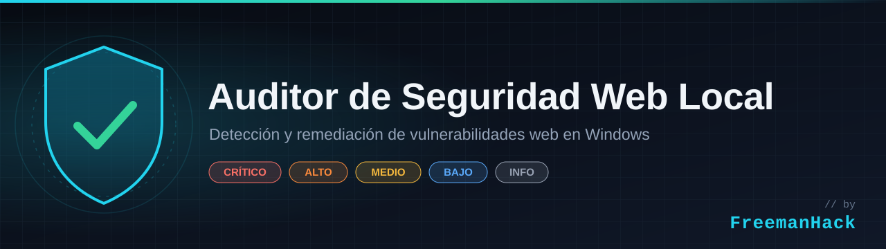
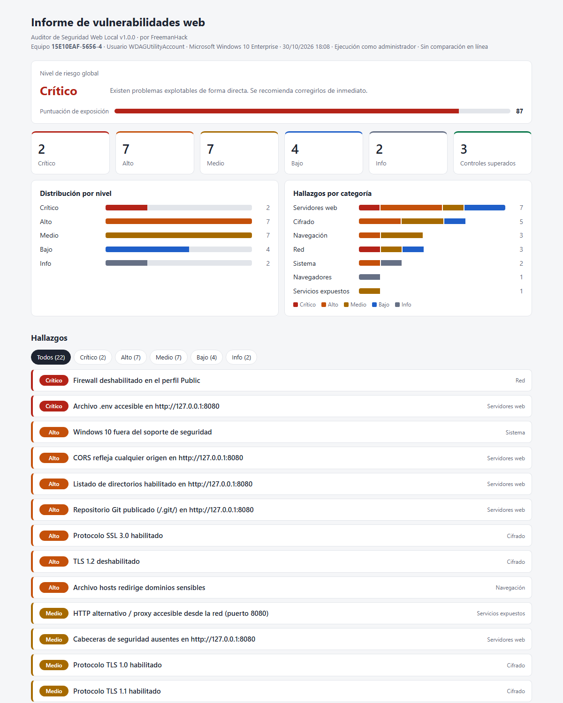
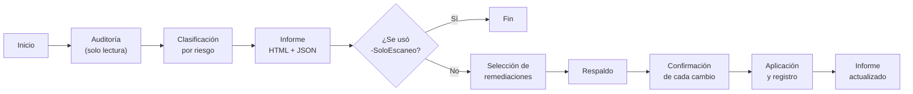

<p align="center">
  
</p>

<p align="center">
  
  
  
  
</p>

<p align="center"><b>Español</b> · <a href="README.en.md">English</a></p>

# Auditor de Seguridad Web Local

Script de PowerShell que detecta y remedia vulnerabilidades web en equipos Windows. Revisa los servicios HTTP en escucha, la configuración TLS del sistema, la versión de los navegadores, el software obsoleto y los parámetros de red que se aprovechan en ataques de suplantación.

El flujo tiene tres etapas:

1. **Auditoría:** se ejecutan todas las verificaciones sobre el equipo.
2. **Clasificación:** cada hallazgo recibe un nivel de riesgo y todos se reúnen en un informe HTML.
3. **Remediación:** la consola ofrece aplicar las remediaciones disponibles. Cada una muestra el comando exacto y pide confirmación, y antes del primer cambio se respaldan el registro y el firewall.

> **Alcance:** la herramienta solo audita el equipo en el que se ejecuta. Los servidores web se analizan únicamente a través de `127.0.0.1`; no se analizan hosts remotos.

<p align="center">
  
</p>
<p align="center"><sub>Informe generado en Windows Sandbox durante la prueba de remediaciones.</sub></p>

## Contenido

- [Inicio rápido](#inicio-rápido)
- [¿Por qué usarlo?](#por-qué-usarlo)
- [Cómo funciona](#cómo-funciona)
- [Verificaciones](#verificaciones)
- [Requisitos](#requisitos)
- [Uso](#uso)
- [Informe](#informe)
- [Remediación asistida](#remediación-asistida)
- [Cómo revertir los cambios](#cómo-revertir-los-cambios)
- [Clasificación del riesgo](#clasificación-del-riesgo)
- [Firma del script](#firma-del-script)
- [Pruebas](#pruebas)
- [Limitaciones](#limitaciones)
- [Preguntas frecuentes](#preguntas-frecuentes)
- [Privacidad](#privacidad)
- [Aviso](#aviso)
- [Contribuir](#contribuir)
- [Seguridad](#seguridad)
- [Autor](#autor)
- [Licencia](#licencia)

## Inicio rápido

1. Descarga `AuditorWebLocal.ps1` desde la [última versión publicada](../../releases/latest).
2. Abre PowerShell **como administrador** en la carpeta donde lo guardaste y desbloquea el archivo:
   ```powershell
   Unblock-File .\AuditorWebLocal.ps1
   ```
3. Ejecútalo:
   ```powershell
   powershell -ExecutionPolicy Bypass -File .\AuditorWebLocal.ps1
   ```

Al terminar, el informe se abre en el navegador y la consola ofrece aplicar las remediaciones disponibles. Si solo quieres el diagnóstico, agrega `-SoloEscaneo`.

## ¿Por qué usarlo?

En una organización, a un atacante le basta con un solo equipo mal configurado. No necesita vulnerar el firewall perimetral ni el servidor mejor protegido: le sirve el equipo de un desarrollador que dejó un servicio abierto o un puesto que todavía responde a LLMNR. Desde ahí puede avanzar hacia el resto de la red.

Estas debilidades no son excepcionales. Muchas vienen habilitadas por defecto en Windows, otras aparecen con el trabajo diario y casi ninguna genera alertas.

### Lo que puede ocurrir

| Debilidad | Consecuencia para la organización |
|---|---|
| Servidor de desarrollo escuchando en `0.0.0.0` con un `.env` accesible | Cualquier equipo de la red obtiene credenciales de bases de datos, claves de API o secretos de producción. |
| Repositorio `.git` publicado | Se puede reconstruir el código fuente completo, incluidas las contraseñas que se subieron alguna vez al historial. |
| LLMNR o NetBIOS habilitados | Un atacante conectado a la red captura los hashes NTLMv2 de los empleados para crackearlos o retransmitirlos (*NTLM relay*) y moverse lateralmente. |
| CORS permisivo en un servicio local | Un sitio malicioso que visita el usuario lee los datos de la aplicación interna desde su propio navegador, sin que el servicio esté expuesto a la red. |
| Navegador desactualizado | Basta con abrir una página maliciosa para que se ejecute un exploit; las vulnerabilidades de navegadores aparecen con frecuencia en el catálogo [CISA KEV](https://www.cisa.gov/known-exploited-vulnerabilities-catalog) de fallos explotados activamente. |
| Archivo `hosts` o proxy alterados | Las credenciales corporativas se envían a un sitio falso aunque el usuario escriba la dirección correcta. |
| Sistema operativo sin soporte | Cada vulnerabilidad nueva queda sin parchear de forma permanente. |

### Por qué suele pasar inadvertido

Ninguna de las herramientas habituales revisa estas debilidades en conjunto:

- **Los escáneres de aplicaciones** (OWASP ZAP, Burp Suite, Nikto) analizan un sitio concreto, no la configuración del equipo que lo aloja o lo consume.
- **El antivirus o EDR** detecta malware y comportamientos sospechosos, pero no una configuración insegura.
- **Windows Update** parchea el sistema, pero no cambia los valores inseguros por defecto, como LLMNR, NetBIOS o los protocolos TLS obsoletos.
- **Los escáneres de vulnerabilidades de red** ven el equipo desde fuera, así que pasan por alto lo que solo es visible desde dentro: archivos `hosts`, proxies, servicios en loopback o software sin soporte.

### Qué aporta en una organización

- **Diagnóstico homogéneo de los puestos de trabajo**, en especial los de desarrolladores y administradores, que concentran privilegios, credenciales y servicios locales.
- **Priorización por riesgo**, para que el equipo de TI dedique su tiempo primero a lo que puede comprometer la red.
- **Evidencia para auditorías:** informes HTML y JSON fechados por equipo, con el detalle técnico de cada hallazgo y su estado.
- **Trazabilidad de los cambios:** cada remediación se muestra antes de aplicarse, se confirma de forma individual, queda registrada en un log y se puede revertir desde el respaldo.
- **Apoyo a marcos de seguridad:** contribuye a los controles de configuración segura y gestión de vulnerabilidades técnicas de [CIS Controls v8](https://www.cisecurity.org/controls/v8) (controles 4 y 7) y de ISO/IEC 27001:2022 (controles A.8.8 y A.8.9). La herramienta no certifica el cumplimiento, pero aporta evidencia para demostrarlo.
- **Sin riesgos añadidos en la cadena de suministro:** es un único script auditable que usa solo componentes nativos de Windows. No instala agentes, no tiene dependencias externas y no envía datos del equipo a terceros.
- **Código verificable:** cada comprobación está documentada con su referencia técnica (RFC, CVE, CWE, OWASP, MITRE ATT&CK), para que el equipo de seguridad pueda validar los criterios antes de adoptarla.

Detectar estas debilidades lleva unos minutos por equipo. Responder a un incidente originado por cualquiera de ellas puede llevar semanas.

## Cómo funciona



1. **Inicio.** El script comprueba si tiene permisos de administrador y si `winget` está disponible, porque de eso depende qué verificaciones y remediaciones puede ejecutar.
2. **Auditoría.** Se ejecutan once verificaciones independientes, cada una dedicada a un área: sistema operativo, firewall, antivirus, puertos en escucha, servidores web, protocolos TLS, resolución de nombres, navegadores, software obsoleto, archivo `hosts` y proxy. Esta etapa solo lee la configuración. Las peticiones a los servidores web se envían a `127.0.0.1`, sin seguir redirecciones ni pasar por el proxy del sistema.
3. **Clasificación.** Cada hallazgo recibe un nivel de riesgo. Si un servidor web solo es accesible desde el propio equipo, sus hallazgos bajan un nivel, salvo los de CORS. Con todos los hallazgos se calculan el nivel global (el más grave) y la puntuación de exposición (la suma de los pesos).
4. **Informe.** Se generan el informe HTML, que se abre en el navegador, y el JSON con los mismos datos.
5. **Remediación.** Salvo que se haya indicado `-SoloEscaneo`, la consola lista los hallazgos con remediación disponible. Antes del primer cambio se respaldan el registro y el firewall; después, cada remediación muestra su comando, pide confirmación, se ejecuta y queda registrada. Al terminar, el informe se regenera con el estado actualizado.

Las remediaciones son de dos tipos:

- **Automáticas:** cambian la configuración directamente, por ejemplo al desactivar TLS 1.0, bloquear un puerto en el firewall o actualizar un navegador con `winget`.
- **Asistidas:** abren la herramienta adecuada para que el usuario decida, como Windows Update, el archivo `hosts` o Programas y características.

Los problemas propios de cada aplicación web, como un `.env` publicado o la falta de cabeceras de seguridad, no se corrigen de forma automática, porque la solución depende de cada servidor. El informe incluye la recomendación para cada caso, con ejemplos de configuración para servidores habituales como Apache, nginx o IIS.

### Decisiones de diseño

- **La auditoría y la remediación están separadas.** Las verificaciones nunca modifican el equipo; los cambios solo ocurren en la etapa de remediación y con confirmación explícita.
- **Ningún cambio es invisible.** Cada remediación muestra el código exacto que se va a ejecutar, y ese mismo código aparece en el informe y en el JSON.
- **Todo cambio es reversible.** El respaldo se crea antes de la primera modificación y el procedimiento para revertirla está documentado y probado.
- **Un fallo no detiene el análisis.** Si una verificación no puede ejecutarse, por ejemplo por falta de permisos, se registra como hallazgo informativo y las demás continúan.
- **El informe no confía en los datos del equipo.** Todo lo que procede del sistema auditado (cabeceras HTTP, nombres de procesos, entradas del archivo `hosts`) se codifica antes de escribirse en el HTML, para que un servidor malicioso no pueda inyectar código en él.
- **Sin dependencias.** Solo se usan componentes nativos de Windows y PowerShell 5.1, sin módulos externos ni instalación.

La estructura interna del script, la función de cada componente y los pasos para agregar una verificación nueva se describen en [docs/arquitectura.md](docs/arquitectura.md).

## Verificaciones

| Categoría | Qué se revisa | Riesgo máximo | Remediación automática |
|---|---|---|---|
| Sistema | Windows 10 fuera de soporte (build < 22000) | Alto | No (abre Windows Update) |
| Sistema | Días desde la última actualización instalada (> 35 / > 60) | Alto | No (abre Windows Update) |
| Sistema | Protección en tiempo real de Defender y antigüedad de las firmas | Alto | Sí |
| Red | Perfiles del firewall deshabilitados | Crítico | Sí |
| Red | LLMNR habilitado (envenenamiento LLMNR/WPAD) | Medio | Sí |
| Red | NetBIOS sobre TCP/IP habilitado (NBT-NS) | Bajo | Sí |
| Servicios expuestos | Puertos web y de bases de datos escuchando fuera de loopback | Alto | Sí (regla de bloqueo entrante) |
| Servidores web | Versión del software visible en `Server` o `X-Powered-By` | Bajo | No |
| Servidores web | Falta de `CSP`, `X-Frame-Options`, `X-Content-Type-Options`, `Referrer-Policy` o `HSTS` | Medio | No |
| Servidores web | CORS que refleja cualquier `Origin` o usa el comodín `*` | Alto | No |
| Servidores web | Cookies sin `HttpOnly`, `Secure` o `SameSite` | Bajo | No |
| Servidores web | Listado de directorios en la raíz | Alto | No |
| Servidores web | Archivos sensibles publicados: `.env`, `.git/HEAD`, volcados SQL, `web.config`, `phpinfo`, `phpMyAdmin`, `server-status`, `.htaccess` | Crítico | No |
| Servidores web | MySQL de XAMPP con `root` sin contraseña | Alto | No |
| Cifrado | SSL 3.0, TLS 1.0 y TLS 1.1 habilitados en SChannel | Alto | Sí |
| Cifrado | TLS 1.2 deshabilitado | Alto | Sí |
| Cifrado | .NET Framework 4.x sin `SchUseStrongCrypto` | Bajo | Sí |
| Navegadores | Chrome, Edge y Firefox frente a la última versión estable | Alto | Sí (`winget upgrade`) |
| Software obsoleto | Flash Player, Silverlight, Shockwave, QuickTime, Java 8 | Crítico | No (abre Programas y características) |
| Software obsoleto | Componente opcional de Internet Explorer 11 | Bajo | Sí |
| Navegación | Archivo `hosts` que redirige dominios sensibles o bloquea actualizaciones | Alto | No (abre el archivo) |
| Navegación | Proxy manual o script PAC configurado | Medio | Sí |

Si un servidor web solo escucha en loopback, sus hallazgos bajan un nivel de riesgo. La excepción es CORS: ese ataque se lanza desde el navegador del propio equipo, así que no depende de que el servicio esté expuesto a la red.

## Requisitos

- Windows 10 u 11.
- Windows PowerShell 5.1, incluido en el sistema.
- Permisos de administrador para verificar el componente Internet Explorer 11 y para aplicar la mayoría de las remediaciones. Sin ellos, el análisis se completa igual y las acciones que necesitan elevación se omiten.
- Conexión a internet para comparar las versiones de los navegadores. Es opcional (ver `-SinConexion`).
- `winget` para actualizar los navegadores de forma automática. También es opcional.

## Uso

```powershell
# Auditoría, informe y remediación (modo por defecto)
powershell -ExecutionPolicy Bypass -File .\AuditorWebLocal.ps1

# Solo análisis e informe
powershell -ExecutionPolicy Bypass -File .\AuditorWebLocal.ps1 -SoloEscaneo

# Sin consultas externas y con el informe en otra carpeta
powershell -ExecutionPolicy Bypass -File .\AuditorWebLocal.ps1 -SinConexion -RutaInforme C:\auditorias
```

Si el archivo se descargó de internet, Windows puede bloquearlo. Para desbloquearlo:

```powershell
Unblock-File .\AuditorWebLocal.ps1
```

### Parámetros

| Parámetro | Descripción |
|---|---|
| `-SoloEscaneo` | Genera el informe sin mostrar el menú de remediación. |
| `-SinConexion` | No consulta las API de versiones de Google, Mozilla y Microsoft. |
| `-RutaInforme <ruta>` | Carpeta donde se guardan los informes, los respaldos y el registro de acciones. Por defecto, `.\informes`. |
| `-NoAbrir` | No abre el informe en el navegador al terminar. |

### Fuentes de versiones

| Navegador | Endpoint |
|---|---|
| Google Chrome | `https://versionhistory.googleapis.com/v1/chrome/platforms/win64/channels/stable/versions` |
| Mozilla Firefox | `https://product-details.mozilla.org/1.0/firefox_versions.json` |
| Microsoft Edge | `https://edgeupdates.microsoft.com/api/products` |

## Informe

Cada ejecución genera dos archivos:

- **`informe-<EQUIPO>-<fecha>.html`**: informe autocontenido, sin dependencias externas. Incluye:
  - el nivel de riesgo global y la puntuación de exposición;
  - la distribución de hallazgos por nivel y por categoría;
  - la lista de hallazgos, filtrable por nivel, con el detalle técnico, la recomendación y el comando de remediación listo para copiar;
  - los controles superados;
  - la fecha y hora del análisis, como recordatorio de que el resultado describe un momento concreto.

  Se adapta al tema claro u oscuro del sistema y se puede imprimir o exportar a PDF desde el navegador: al hacerlo, todos los hallazgos se despliegan y se ocultan los controles interactivos, lo que resulta útil para entregarlo como evidencia.
- **`informe-<EQUIPO>-<fecha>.json`**: los mismos hallazgos en formato estructurado, para integrarlos con otras herramientas.

Ejemplo de un hallazgo en el JSON:

```json
{
  "Id": 9,
  "Categoria": "Cifrado",
  "Titulo": "Protocolo TLS 1.0 habilitado",
  "Riesgo": "Medio",
  "Vulnerable": true,
  "Detalle": "...",
  "Recomendacion": "...",
  "Correccion": "foreach ($rol in 'Client', 'Server') { ... }",
  "RequiereAdmin": true,
  "Estado": "Pendiente"
}
```

Valores posibles de `Estado`: `Pendiente`, `OK`, `Corregido`, `Omitido por el usuario`, `Omitido (requiere administrador)` y `Error: <mensaje>`.

## Remediación asistida

Es el comportamiento por defecto; para obtener solo el informe se usa `-SoloEscaneo`. Al terminar el análisis, la consola muestra los hallazgos que tienen remediación disponible. Se pueden elegir por su ID, separados por comas, o todos a la vez con `T`. Para cada uno:

1. Se muestra el código PowerShell exacto que se va a ejecutar.
2. Se pide confirmación (`S`/`N`).
3. Se ejecuta con `$ErrorActionPreference = 'Stop'` y el resultado queda registrado en `correcciones.log`.

Si la sesión no tiene permisos de administrador y alguna remediación los necesita, se ofrece volver a abrir el script con esos permisos. Después de aplicar los cambios, el informe se regenera con el estado actualizado.

Los cambios en SChannel y en las características opcionales de Windows requieren reiniciar el equipo para aplicarse.

## Cómo revertir los cambios

Antes de aplicar la primera remediación se crea la carpeta `respaldo-<fecha>\` con estos archivos:

| Archivo | Contenido |
|---|---|
| `schannel.reg` | `HKLM\SYSTEM\CurrentControlSet\Control\SecurityProviders\SCHANNEL` |
| `dotnet.reg`, `dotnet-wow64.reg` | `HKLM\SOFTWARE\[WOW6432Node\]Microsoft\.NETFramework\v4.0.30319` |
| `dnsclient.reg` | `HKLM\SOFTWARE\Policies\Microsoft\Windows NT\DNSClient` |
| `internet-settings.reg` | `HKCU\Software\Microsoft\Windows\CurrentVersion\Internet Settings` |
| `firewall.wfw` | Política completa del firewall (solo con permisos de administrador) |

Si una clave no existía al momento del respaldo, no se genera su archivo.

Importar un `.reg` restaura los valores guardados, pero no borra las claves ni los valores que se crearon después. Esos hay que eliminarlos a mano:

```powershell
# Protocolos TLS/SSL: eliminar la subclave que creó la remediación
Remove-Item 'HKLM:\SYSTEM\CurrentControlSet\Control\SecurityProviders\SCHANNEL\Protocols\TLS 1.0' -Recurse

# .NET Framework: eliminar los valores agregados (repetir en la ruta WOW6432Node)
Remove-ItemProperty 'HKLM:\SOFTWARE\Microsoft\.NETFramework\v4.0.30319' -Name SchUseStrongCrypto, SystemDefaultTlsVersions

# LLMNR: eliminar la directiva
Remove-ItemProperty 'HKLM:\SOFTWARE\Policies\Microsoft\Windows NT\DNSClient' -Name EnableMulticast
```

Para listar o eliminar las reglas de firewall creadas por la herramienta:

```powershell
Get-NetFirewallRule -DisplayName 'AuditorWebLocal - *'
Remove-NetFirewallRule -DisplayName 'AuditorWebLocal - *'
```

Para restaurar la política completa del firewall:

```powershell
netsh advfirewall import .\informes\respaldo-<fecha>\firewall.wfw
```

NetBIOS se vuelve a habilitar desde las propiedades IPv4 del adaptador (Opciones avanzadas > WINS > Predeterminado), o con `SetTcpipNetbios` y el valor `0`.

## Clasificación del riesgo

| Nivel | Peso | Criterio |
|---|---|---|
| Crítico | 10 | Se puede explotar de forma directa y con impacto grave, como la exposición de secretos o un equipo sin defensas perimetrales. |
| Alto | 6 | Vulnerabilidad conocida o exposición importante que se aprovecha con poco esfuerzo. |
| Medio | 3 | Debilidad que reduce las defensas o facilita ataques encadenados. |
| Bajo | 1 | Buena práctica no aplicada, con impacto limitado. |
| Info | 0 | Dato para revisar a mano; por sí solo no es una vulnerabilidad. |

- **Nivel global:** la severidad más alta entre los hallazgos pendientes.
- **Puntuación de exposición:** la suma de los pesos de los hallazgos pendientes.

## Firma del script

El script se publica sin firma digital. En organizaciones con la directiva de ejecución `AllSigned`, el equipo de TI puede firmarlo con su propio certificado de firma de código antes de distribuirlo:

```powershell
$cert = Get-ChildItem Cert:\CurrentUser\My -CodeSigningCert | Select-Object -First 1
Set-AuthenticodeSignature -FilePath .\AuditorWebLocal.ps1 -Certificate $cert -TimestampServer 'http://timestamp.digicert.com'
```

El sello de tiempo mantiene válida la firma aunque el certificado venza más adelante. Cualquier modificación posterior del archivo invalida la firma, así que conviene firmar la versión definitiva y verificarla con `Get-AuthenticodeSignature`.

## Pruebas

La carpeta `pruebas/` contiene una prueba de extremo a extremo que valida la detección, la remediación y la reversión en un entorno desechable:

| Script | Función |
|---|---|
| `Iniciar-PruebaSandbox.ps1` | Abre Windows Sandbox con el proyecto montado en solo lectura y ejecuta la prueba automáticamente. La ventana se cierra al terminar y todos los cambios se descartan. |
| `Probar-Remediaciones.ps1` | Introduce configuraciones inseguras y un servidor web vulnerable, audita, aplica cada remediación automatizable, vuelve a auditar y comprueba que la reversión documentada deja el equipo en su estado inicial. |

```powershell
.\pruebas\Iniciar-PruebaSandbox.ps1
```

El resultado se guarda en Markdown en `pruebas\resultados\`. Requiere Windows 10/11 Pro, Enterprise o Education con la característica **Windows Sandbox** habilitada. También puede ejecutarse en una máquina virtual con instantánea mediante `Probar-Remediaciones.ps1 -ConfirmoEntornoDesechable`.

> **No ejecutar `Probar-Remediaciones.ps1` en un equipo real:** deshabilita el firewall, modifica el registro y el archivo `hosts`, y configura un proxy.

**Último resultado (Windows 10, compilación 19041, Windows Sandbox):**

- 9 de 9 vulnerabilidades introducidas detectadas.
- 11 de 11 remediaciones automatizables aplicadas y confirmadas al volver a auditar.
- Reversión completa: los hallazgos finales coinciden con los iniciales.

Las remediaciones que dependen de `winget` y las que abren una interfaz (Windows Update, Programas y características, Bloc de notas) no se prueban de forma automática.

## Limitaciones

- Solo se analizan los servidores web que escuchan en puertos habituales: 80, 443, 3000, 4200, 5000, 5173, 8000, 8008, 8080, 8081, 8443, 8888, 9000 y 9090.
- La exposición se deduce de la dirección de escucha. No se tiene en cuenta si alguna regla de firewall ya bloquea el acceso.
- Para evitar falsos positivos en aplicaciones SPA, los archivos sensibles se confirman por su contenido. Aun así, esto no reemplaza un análisis dinámico completo con herramientas como OWASP ZAP, Burp Suite o Nikto.
- Un navegador con una versión anterior se marca como desactualizado aunque pertenezca al canal ESR o tenga la versión fijada por una directiva corporativa.
- Brave y Opera se detectan, pero su versión no se compara en línea.
- La comprobación de soporte de Windows 10 no detecta si el equipo tiene ESU comercial o educativo.
- Durante las peticiones HTTPS se aceptan certificados autofirmados. La validación original se restablece al terminar el análisis.

## Preguntas frecuentes

<details>
<summary><b>¿Por qué hay que usar <code>-ExecutionPolicy Bypass</code>? ¿No es inseguro?</b></summary>

La directiva de ejecución de PowerShell impide ejecutar scripts sin firmar descargados de internet. `-ExecutionPolicy Bypass` la omite **solo para esa ejecución**, sin cambiar la configuración del equipo. Es seguro siempre que revises el script antes de ejecutarlo y compruebes su hash SHA-256 con el publicado en la versión. En entornos con la directiva `AllSigned`, consulta [Firma del script](#firma-del-script).
</details>

<details>
<summary><b>El antivirus marcó el script como sospechoso. ¿Es normal?</b></summary>

Puede ocurrir. El script consulta la configuración de seguridad, modifica el registro y crea reglas de firewall, que son comportamientos que algunos antivirus vigilan. Antes de crear una excepción, comprueba que el hash SHA-256 del archivo coincida con el publicado en la versión. Si no coincide, no lo ejecutes.
</details>

<details>
<summary><b>¿Qué hago si una remediación falla o rompe algo?</b></summary>

El error queda registrado en `correcciones.log` y en el estado del hallazgo dentro del informe. Para deshacer un cambio que ya se aplicó, sigue los pasos de [Cómo revertir los cambios](#cómo-revertir-los-cambios) usando el respaldo que se crea antes de la primera remediación. Los cambios de TLS requieren reiniciar el equipo para aplicarse, así que un efecto inesperado puede aparecer después del reinicio.
</details>

<details>
<summary><b>¿Necesito permisos de administrador?</b></summary>

No para auditar: sin elevación el análisis se completa igual, salvo la verificación de Internet Explorer 11. Sí para la mayoría de las remediaciones. Si hacen falta, el script ofrece volver a abrirse como administrador.
</details>

<details>
<summary><b>¿Envía datos a algún servidor?</b></summary>

No. Las únicas conexiones externas son las consultas de versiones a Google, Mozilla y Microsoft, que no incluyen información del equipo. Con `-SinConexion` tampoco se hacen esas consultas.
</details>

<details>
<summary><b>¿Puedo usarlo en los equipos de mi empresa?</b></summary>

Sí, siempre que cuentes con la autorización del área de TI o de seguridad. En equipos unidos a un dominio, conviene aplicar las remediaciones de registro (TLS, LLMNR, NetBIOS) mediante directivas de grupo: si se aplican solo en el equipo, una GPO puede sobrescribirlas.
</details>

<details>
<summary><b>¿Funciona en Windows Server?</b></summary>

No está probado. La mayoría de las verificaciones son compatibles, pero los valores por defecto de TLS y la verificación de soporte del sistema operativo están pensados para Windows 10 y 11.
</details>

## Privacidad

Los informes incluyen el nombre del equipo, el usuario, los procesos en escucha, las entradas del archivo `hosts` y la configuración del proxy. Por eso el `.gitignore` excluye la carpeta `informes/`, para que no se publique por error.

La herramienta no envía datos del equipo a ningún sitio. Las únicas conexiones externas son las consultas de versiones de navegadores, que no incluyen información del sistema.

## Aviso

Esta herramienta está pensada para diagnosticar equipos propios o equipos que se administran con autorización. En entornos corporativos, su uso debe contar con la aprobación del área de TI o de seguridad de la información. Las remediaciones modifican la configuración del sistema, así que conviene revisar cada comando antes de confirmarlo.

## Contribuir

Las propuestas de nuevas verificaciones, remediaciones y mejoras son bienvenidas. Antes de enviar un aporte, consulta [CONTRIBUTING.md](CONTRIBUTING.md), donde se detallan los criterios técnicos, el estilo de código y la lista de comprobación previa.

## Seguridad

Para informar una vulnerabilidad de la propia herramienta, consulta [SECURITY.md](SECURITY.md). No abras un issue público.

## Autor

Desarrollado por **FreemanHack**.

## Licencia

Distribuido bajo la licencia MIT. Ver [LICENSE](LICENSE).
